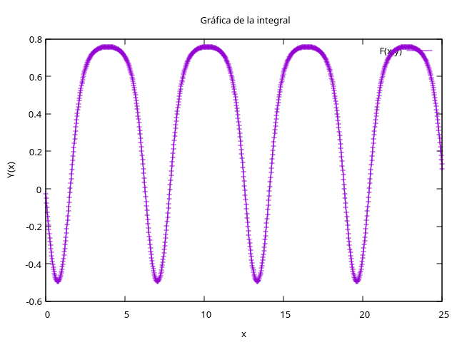

# Física Computacional (FS0432)

Repositorio con todo el trabajo que desarrollé en el curso de **Física Computacional**: laboratorios, tareas y exámenes en los que se resuelven problemas de la física con métodos numéricos, programación orientada a objetos y cómputo de alto rendimiento (paralelismo con **OpenMP** y **MPI**).

> **Autor:** David González ([@davidggonz](https://github.com/davidggonz))

---

## Habilidades demostradas

| Lenguaje / herramienta | Qué demuestra este repositorio | Dónde verlo |
|---|---|---|
| **C++** | Clases con constructor por defecto, personalizado y de copia, destructor, `operator=` y sobrecarga de operadores (`+`, `-`, `*`); gestión de memoria dinámica; separación en `.hpp`/`.cpp`; manejo de excepciones; implementación propia de RK4 | `Exams/Exam_01/Part_01` (clase `Tuple`), `Labs/Lab_07/Lab_7.3/complex` (clase `Complex`), `Homeworks/Homework_03/rk4.cpp` |
| **C++ con OpenMP** (memoria compartida) | Paralelización de bucles con `#pragma omp parallel for`, cláusula `reduction`, medición de tiempos y escalabilidad: producto de matrices, cálculo de π y conjunto de Mandelbrot | `Labs/Lab_08`, `Homeworks/Homework_04` |
| **C++ con MPI** (memoria distribuida) | `MPI_Send`/`MPI_Recv`, `MPI_Sendrecv`, `MPI_Sendrecv_replace`, balanceo de carga cuando `n` no es múltiplo del número de procesos, cálculo de π distribuido y comunicación circular entre procesos | `Labs/Lab_09`, `Exams/Exam_02/circular.cpp` |
| **Python** (NumPy, SciPy, Matplotlib) | Integración y derivación numérica, cuadratura gaussiana, ajuste de curvas, búsqueda de ceros, ODEs, PDEs, FFT/DFT, álgebra lineal y Monte Carlo | `Labs/Lab_01`–`Lab_05`, `Lab_10`–`Lab_13`, `Homeworks/Homework_05` |
| **Jupyter Notebooks** | Informes reproducibles que combinan teoría en LaTeX, código, gráficos y análisis de resultados | Todos los `.ipynb` |
| **Bash / shell scripting** | Procesamiento de texto y datos con `grep`, `sed`, `sort`, `paste` y tuberías (pipes) sobre archivos CSV y `.dat` | `Homeworks/Homework_01` |
| **Gnuplot** | Visualización de resultados desde C++ (tubería a `gnuplot`) | `Homeworks/Homework_03` |
| **Git / GitHub y MkDocs** | Control de versiones con historial de commits y documentación publicable con MkDocs (tema Material, ecuaciones con MathJax) | `Homeworks/Homework_02` |

---

## Resultados destacados

### Solución de una ODE con Runge-Kutta de 4.º orden implementada desde cero en C++
`Homeworks/Homework_03/rk4.cpp` resuelve numéricamente y(x)' = sin(x + y) − cos(x − y) y grafica la solución con Gnuplot.



### Paralelismo en la práctica
- **OpenMP:** cálculo de π por suma de Riemann (punto medio) con `reduction(+: Int)`, producto de matrices y conjunto de Mandelbrot paralelizados por filas.
- **MPI:** cálculo de π con reparto equilibrado del trabajo entre procesos y reducción de resultados, además de patrones de comunicación punto a punto (anillo circular).

### Programación orientada a objetos
Dos clases escritas desde cero, con la "regla de los tres" (destructor, constructor de copia y operador de asignación) y operadores aritméticos sobrecargados:
- `Tuple` – vector dinámico de `double` (Examen 1).
- `Complex` – números complejos con conjugado y norma (Laboratorio 7).

---

## Estructura del repositorio

```
ComputationalPhysics/
├── Labs/          # 13 laboratorios (Python y C++)
├── Homeworks/     # 5 tareas
└── Exams/         # 2 exámenes parciales
```

### Laboratorios

| Lab | Tema | Lenguaje |
|---|---|---|
| 01 | Cálculo de π por integración numérica | Python |
| 02 | Sistemas dinámicos y Runge-Kutta 4 | Python |
| 03 | Integración y derivación básica | Python |
| 04 | Cuadratura gaussiana y ajuste de curvas | Python (SciPy) |
| 05 | Derivadas numéricas y búsqueda de ceros | Python (SciPy) |
| 07 | π por integración, producto de matrices y clase `Complex` | C++ |
| 08 | Paralelismo con OpenMP (matrices y π) | C++ / OpenMP |
| 09 | Paralelismo con MPI (`sendrecv`, π distribuido) | C++ / MPI |
| 10 | Transformada de Fourier discreta (DFT) | Python |
| 11 | EDOs: Euler, RK2, RK4, métodos adaptativos y *leapfrog* | Python |
| 12 | EDPs: Jacobi, Gauss-Seidel, *over-relaxation* y FTCS | Python |
| 13 | Sistemas lineales (Gauss, LU, QR) y números aleatorios / Monte Carlo | Python |

### Tareas

| Tarea | Tema | Lenguaje |
|---|---|---|
| 01 | Manipulación de datos en la terminal (CSV, `grep`, `sed`, `sort`, `paste`) | Bash |
| 02 | Cuadratura gaussiana documentada con MkDocs | Python / MkDocs |
| 03 | Integrador Runge-Kutta 4 con gráfico en Gnuplot | C++ |
| 04 | Producto punto y conjunto de Mandelbrot en paralelo | C++ / OpenMP |
| 05 | Espectro y reconstrucción de señales con FFT | Python |

### Exámenes

| Examen | Contenido |
|---|---|
| 1 | Clase `Tuple` en C++ (parte 1) y cuadratura gaussiana de una integral impropia con polinomios de Legendre (parte 2) |
| 2 | Distribución de Boltzmann por transformación de números uniformes, Monte Carlo y paralelismo de memoria distribuida con MPI |

---

## Cómo ejecutar el código

**Python / notebooks**
```bash
pip install numpy scipy matplotlib jupyter
jupyter notebook
```

**C++ (serial)**
```bash
g++ -O2 -o programa main.cpp tuple.cpp
./programa
```

**C++ con OpenMP**
```bash
g++ -O2 -fopenmp -o pi_parallel pi_parallel.cpp
OMP_NUM_THREADS=4 ./pi_parallel
```

**C++ con MPI**
```bash
mpic++ -O2 -o pi_mpi pi_distributed_memory.cpp
mpirun -np 4 ./pi_mpi --n 1000000
```

**Documentación MkDocs (Tarea 2)**
```bash
cd Homeworks/Homework_02
pip install mkdocs mkdocs-material mkdocstrings
mkdocs serve
```

---

## Temas cubiertos

Integración numérica (Riemann, cuadratura gaussiana) · derivación numérica · ajuste de curvas · búsqueda de raíces · EDOs (Euler, RK2, RK4, adaptativos, *leapfrog*) · EDPs (elípticas y parabólicas) · transformada de Fourier (DFT/FFT) · álgebra lineal numérica (Gauss, LU, QR) · números aleatorios y Monte Carlo · programación orientada a objetos · cómputo paralelo (OpenMP y MPI) · scripting en shell · control de versiones y documentación.
